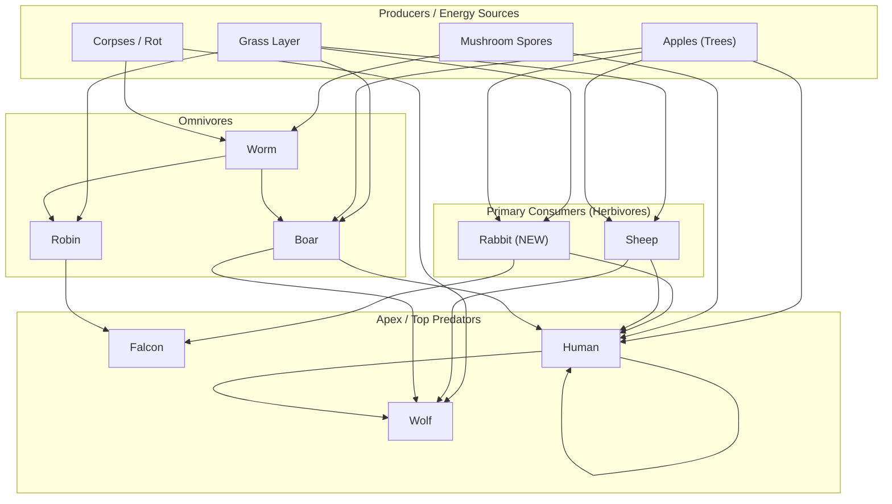

# Feleco Food Web & Energy Exchange Flowchart

## Overview

This document describes the complete energy exchange system for the Feleco ecology simulation, including all producer-consumer relationships, predation rules, and the new **Human Settlement Alliance** mechanic.

---

## Energy Flow Diagram

---

## Species-by-Species Rules

### Producers (Not Counted in Game Mechanics)

| Entity | Role | Eaten By | Rules |
|--------|------|----------|-------|
| **Grass** | Primary producer | Sheep, Rabbit, Boar, Robin | Regrows via CA tick. Seasonal boost affects growth rate. |
| **Mushroom Spores** | Decomposer/Producer | Worms, Humans | Drift from sky, anchor to ground, spread via mycelium network. |
| **Apples** | Tree fruit | Sheep, Rabbit, Boar, Human | Grows on trees. Tree planting by arborist failsafe. |
| **Corpses** | Recycling | Worms, Wolves | Spawned on death. Absorbable energy decays over time. |
| **Worms** | Decomposer/Recycler | Boars, Robins | Eat spores and corpses. Reproduce near corpses. **Not counted.** |

### Primary Consumers (Herbivores)

| Entity | Diet | Predators | Rules |
|--------|------|-----------|-------|
| **Sheep** | Grass | Wolves, Humans | Graze in flocks. Flee from wolves. Reproduce when well-fed. **Bettable.** |
| **Rabbit** | Grass, Apples | Falcons, Humans | Fast, small. Too fast for wolves. Too little meat for wolves. **Bettable. NEW.** |

### Omnivores

| Entity | Diet | Predators | Rules |
|--------|------|-----------|-------|
| **Boar** | Grass, Apples, Worms | Wolves, Humans | Charge when threatened. Medium speed. **Bettable.** |
| **Robin** | Worms, Grass seeds | Falcons | Aerial. Eats worms and small grass seeds. **Bettable.** |

### Apex Predators

| Entity | Diet | Predators | Rules |
|--------|------|-----------|-------|
| **Falcon** | Robins, Rabbits | None | Aerial hunter. Cannot catch sheep or boar. **Bettable.** |
| **Wolf** | Sheep, Boar, Humans | None | Pack hunter. Human prey only when desperate or in large packs. **Bettable.** |
| **Human** | Sheep, Boar, Rabbit, Apple, Mushroom, Human | Wolves, Humans | Top of food chain. Builds settlements. Forms alliances. **Bettable.** |

---

## Human Settlement Alliance Mechanic (NEW)

### How It Works

1. **Settlement Founding**
   - When a human reproduces inside a shelter radius, the offspring is tagged with that settlement ID.
   - Humans can also found new settlements when population pressure is high and no nearby shelter exists.

2. **Alliance / Faction System**
   - Each human belongs to one settlement faction.
   - Humans share a faction with their birth settlement.
   - Allies do not attack each other.

3. **Inter-Settlement Conflict**
   - Humans from **different** settlements are treated as hostile.
   - Hostile humans can attack, steal from, or drive off other settlement humans.
   - Combat uses existing human damage/health system.

4. **Population Checks**
   - Wolves and inter-human conflict keep human populations in check.
   - Disease (spread by RotLayer proximity) adds random mortality.
   - Old age still applies.

### Why This Balances Humans

| Threat | Source | Mitigation |
|--------|--------|------------|
| Wolves | External predation | Humans must stay in groups or build shelters |
| Other Humans | Inter-settlement war | Divides human attention, reduces unified growth |
| Disease | RotLayer random spread | Unpredictable mortality |
| Old Age | Lifespan timer | Hard cap on individual survival |
| Famine | Grass/mushroom scarcity | Forces expansion, riskier travel |

---

## Counted vs. Not Counted

### Counted in Game Mechanics / Left Counter / Bettable
- Sheep
- Wolf
- Human
- Falcon
- Robin
- Boar
- **Rabbit (NEW)**

### Rendered but NOT Counted
- Worm
- Grass
- Mushroom / Spore
- Apple
- Corpse
- Tree

---

## Rabbit Integration Plan (Pending Approval)

### Stats (proposed)
- `walk_speed`: 4.5 (fast, evades wolves)
- `metabolism_rate`: 0.4
- `repro_threshold`: 12.0
- `repro_cost`: 4.0
- `lifespan`: 15.0
- `health`: 8.0
- `energy`: 15.0

### Behavior
- State machine: "Graze", "Flee"
- Graze: eat grass (reduces grass density) + seek apples
- Flee: run from Humans, Falcons, and Wolves (even though wolves rarely catch them)
- Reproduce: fast breeders, high density tolerance

### Predation Rules
- **Falcons**: primary predator. Hunt robins AND rabbits.
- **Humans**: secondary predator. Hunt rabbits when sheep/boar scarce.
- **Wolves**: do NOT hunt rabbits (too fast, too little meat).

### Visual
- Small sprite: ~0.6 world units
- Color: light brown / tan
- Procedural shape: small round body + long ears

---

## Energy Balance Notes

To ensure producers feed the system:

1. **Grass** density is already tuned via `cfg_grass_density` and seasonal boosts.
2. **Mushroom spores** drift and anchor automatically; mycelium layer spreads them.
3. **Apples** grow on trees; trees are planted by arborist failsafe and agent actions.
4. **Worms** eat corpses and spores, becoming food for boars and robins.
5. **Rabbits** eat grass and apples, becoming food for falcons and humans.

The addition of rabbits adds another grass consumer, which may require tuning `cfg_grass_density` or grass regrowth rates upward.
